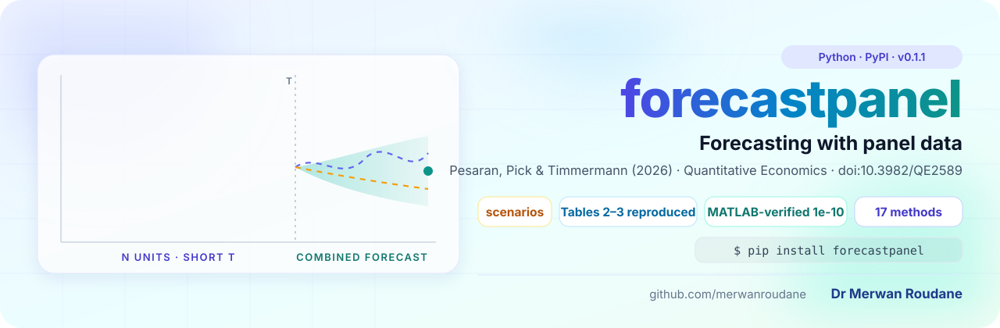
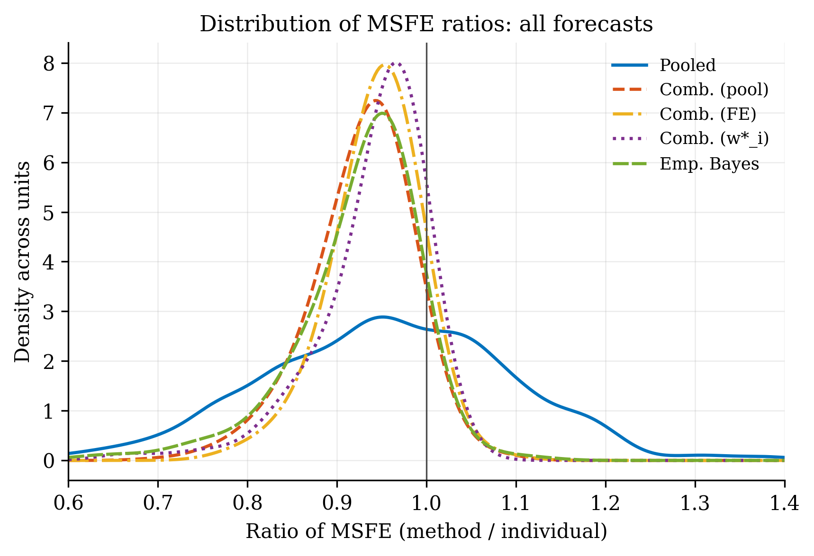
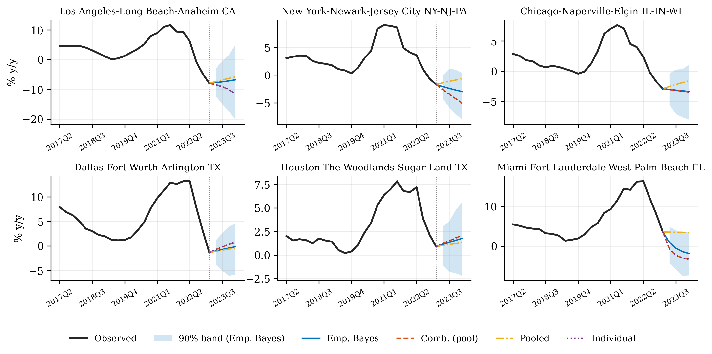
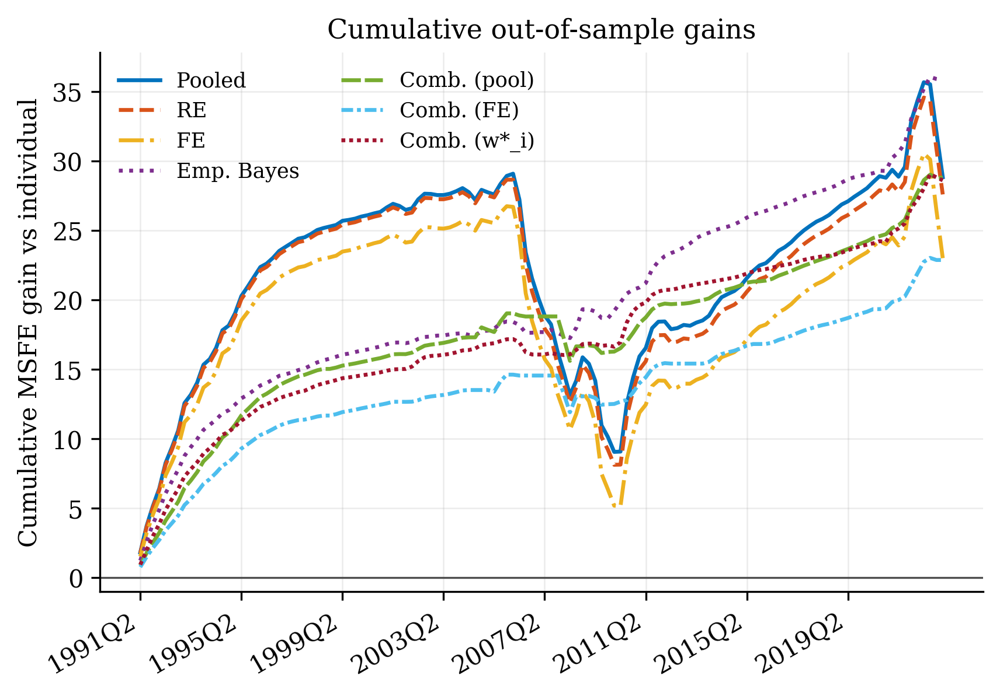
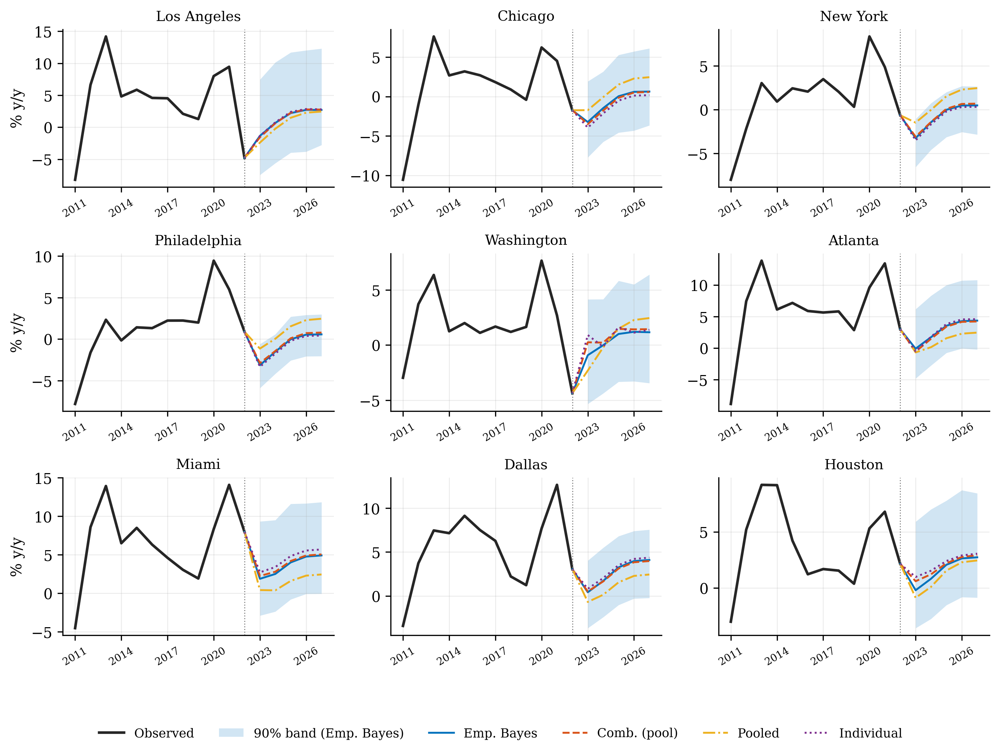

<p align="center">
  
</p>

<p align="center">
  <a href="https://pypi.org/project/forecastpanel/"></a>
  <a href="https://pypi.org/project/forecastpanel/"></a>
  <a href="https://github.com/merwanroudane/forecastpanel/actions"></a>
  <a href="https://doi.org/10.3982/QE2589"></a>
  <a href="https://merwanroudane.github.io/forecastpanel/"></a>
  <a href="LICENSE"></a>
</p>

# forecastpanel

**forecastpanel** implements the panel forecasting methods of
**Pesaran, Pick and Timmermann (2026), "Forecasting with panel data: Estimation uncertainty
versus parameter heterogeneity", *Quantitative Economics* 17(2), 342–393,
[doi:10.3982/QE2589](https://doi.org/10.3982/QE2589)** in Python. You get individual,
pooled, fixed-effects, random-effects and empirical Bayes forecasts, the paper's optimal
forecast combinations, evaluation tables and panel Diebold–Mariano tests in a few lines of
code. The package also adds multi-step scenario forecasts and bootstrap intervals for small
firm, sector or country panels.

📖 **Documentation:** https://merwanroudane.github.io/forecastpanel/
📦 **PyPI:** https://pypi.org/project/forecastpanel/
🧑‍💻 **Author:** Dr Merwan Roudane · merwanroudane920@gmail.com · https://github.com/merwanroudane

---

## Table of contents
1. [What this package does](#1-what-this-package-does)
2. [Start from absolutely nothing](#2-start-from-absolutely-nothing)
3. [Installation](#3-installation)
4. [Your first forecasts in 60 seconds](#4-your-first-forecasts-in-60-seconds)
5. [Complete example with real data: US house prices](#5-complete-example-with-real-data-us-house-prices)
6. [Small panels: annual data, scenarios and intervals](#6-small-panels-annual-data-scenarios-and-intervals)
7. [Full syntax reference](#7-full-syntax-reference)
8. [Interpreting the output](#8-interpreting-the-output)
9. [Using your own Excel or CSV file](#9-using-your-own-excel-or-csv-file)
10. [Exporting tables and figures](#10-exporting-tables-and-figures)
11. [The method](#11-the-method)
12. [Compatibility with the authors' code and what differs](#12-compatibility-with-the-authors-code-and-what-differs)
13. [Practical guidance and pitfalls](#13-practical-guidance-and-pitfalls)
14. [Limitations](#14-limitations)
15. [References](#15-references)
16. [Citation](#16-citation)
17. [Author and licence](#17-author-and-licence)

---

## 1. What this package does

With panel data (many units — firms, regions, countries, products — observed over time) you
can forecast each unit **from its own history only** (no bias, but noisy when T is short),
**pool** all units into one regression (precise, but biased if units differ), or do something
in between. Pesaran, Pick and Timmermann (2026) show that the best choice depends on the
trade-off between **estimation uncertainty** (small T) and **parameter heterogeneity**.
They also derive forecast combinations and empirical Bayes forecasts that adapt to the data.

You supply a long-format table (unit, period, target, predictors). You get forecasts from every
method, the estimated combination weights with their components, tables of out-of-sample
accuracy, Diebold–Mariano tests, and publication-ready figures.

| Feature | Source |
|---|---|
| Individual, pooled, FE, RE (Goldberger BLUP), empirical Bayes forecasts | PPT (2026) eqs. (11), (12), (25), (44), Supplement (S.16) |
| Optimal common weights individual/pooled and individual/FE | PPT (2026) eqs. (32), (39), (40)–(43), (79)–(81) |
| Unit-specific combination weights, equal weights, oracle weights | PPT (2026) eqs. (36), (46); Table S.4 |
| Hierarchical Bayes (Gibbs sampler) | Lindley and Smith (1972); Supplement S.3 |
| Out-of-sample Table 2, Table 3, Figure 1 | PPT (2026), Section 6 |
| Panel DM test and unit DM/HLN tests | Pesaran, Pick and Pranovich (2013); Diebold and Mariano (1995); Harvey et al. (1997) |
| Monte Carlo DGP, PR², Δ_AR | PPT (2026) Section 5, Supplement S.2, Appendix D |
| **Extensions:** Stein shrinkage, iterative Bayes, Mallows pooling averaging, RE-AR(1) BLUP, mean group, regularised Ω | Maddala et al. (1997); Wang, Zhang and Paap (2019); Baltagi and Li (1992); Pesaran and Smith (1995) |
| **Extensions:** multi-step iterated forecasts, scenarios, offsets, bootstrap intervals, expanding windows | — |
| Real datasets: house prices of 377 MSAs, 187 CPI sub-indices | the paper's two applications |

Every forecast has been checked against the authors' MATLAB replication code to 1e-10, and
the published Tables 2 and 3 (house prices) are reproduced exactly (§12).

## 2. Start from absolutely nothing

*If you have never used Python, do these four steps once. It takes about fifteen minutes.*

### Step 1 — install Python
Download **Anaconda** (recommended: it bundles Python, Jupyter and Spyder) from
https://www.anaconda.com/download, or plain Python from https://www.python.org/downloads/.
With the python.org installer, **tick "Add Python to PATH"** on the first screen.

### Step 2 — open a terminal
- **Windows:** press the `Windows` key, type `Anaconda Prompt` (or `cmd`), press Enter.
- **macOS:** press `Cmd + Space`, type `Terminal`, press Enter.

Check that Python works:
```bash
python --version
```
You should see something like `Python 3.11.5`.

### Step 3 — install this package
```bash
pip install forecastpanel
```

### Step 4 — check it
Type `python`, press Enter, then paste:
```python
import forecastpanel as fp
print(fp.__version__)
```
Type `exit()` to leave.

### Where do I write my code?
| Tool | Best for | How to open |
|---|---|---|
| **Jupyter Notebook** | step-by-step work with tables and figures inline | type `jupyter notebook` in the terminal |
| **Spyder** | a MATLAB/RStudio-like window | type `spyder`, or open it from Anaconda Navigator |
| **A `.py` file** | a reproducible script | save `analysis.py`, then run `python analysis.py` |

## 3. Installation

```bash
pip install forecastpanel
```
Optional extras:
```bash
pip install "forecastpanel[excel]"
```
```bash
pip install "forecastpanel[fast]"
```
`excel` adds `openpyxl` for reading `.xlsx` files; `fast` adds `joblib` for parallel Monte Carlo.
Development version:
```bash
pip install git+https://github.com/merwanroudane/forecastpanel.git
```
Requirements: Python ≥ 3.10 with numpy, scipy, pandas and matplotlib (installed automatically).

## 4. Your first forecasts in 60 seconds

```python
import forecastpanel as fp

df = fp.load_house_prices(with_neighbors_only=True)        # real data shipped with the package
model = fp.PanelForecaster(df, unit="msa", time="quarter", y="dhp",
                           y_lags=[1], x={"dhp_us": 1})     # own lag + lagged national inflation
res = model.fit(window=40)                                   # last 40 quarters
print(res.forecast(horizon=1).round(3).head())
```
```
               Individual  Pooled     RE      FE  Emp. Bayes  Comb. (pool)  Comb. (FE)  Comb. (w*_i)  Eq.w. (pool)  Eq.w. (FE)
msa   quarter
10540 2023Q2       -8.805  -6.109 -6.124  -6.181      -7.560        -8.805      -8.805        -7.508        -7.457      -7.493
12540 2023Q2       -5.089  -4.622 -4.715  -4.961      -4.823        -5.089      -5.089        -4.911        -4.855      -5.025
13380 2023Q2      -13.380  -9.795 -9.850 -10.009     -12.374       -13.380     -13.380       -12.294       -11.588     -11.694
13460 2023Q2       -7.552  -6.850 -6.914  -7.105      -7.200        -7.552      -7.552        -7.270        -7.201      -7.329
14740 2023Q2      -11.372  -9.396 -9.421  -9.507     -11.229       -11.372     -11.372       -10.874       -10.384     -10.440
```
One row per unit and forecast period, one column per method.

## 5. Complete example with real data: US house prices

The dataset is real house-price inflation (4-quarter log change of the Freddie Mac index
deflated by the CPI, %) in 362 US metropolitan areas, 1976Q1–2023Q1, together with the
spatial, regional and national averages. These are the data of Section 6.2 of the paper.
The script below is [`examples/house_prices_replication.py`](examples/house_prices_replication.py).

```python
import forecastpanel as fp

# Step 1 - data (long format: one row per MSA and quarter)
df = fp.load_house_prices(with_neighbors_only=True)

# Step 2 - the paper's model (52): own lag, spatial lag, regional and national averages
model = fp.PanelForecaster(df, unit="msa", time="quarter", y="dhp",
                           y_lags=[1], x={"dhp_spatial": 1, "dhp_region": 1, "dhp_us": 1},
                           methods="paper")

# Step 3 - rolling windows of 60 quarters, 128 one-step forecasts (1991Q2-2023Q1)
ev = model.evaluate(window=60, n_forecasts=128)
print(ev.summary())               # Table 2 + Table 3 of the paper
```
```
                     Ratio of ave. MSFE    Freq. beating benchmar   Freq. smallest MSFE      Freq. largest MSFE
                       all     k=0   k=+-1     all     k=0   k=+-1     all     k=0   k=+-1     all     k=0   k=+-1
------------------------------------------------------------------------------------------------------------------
Individual           2.822   2.258   2.908      --      --      --   0.011   0.108   0.130   0.569   0.561   0.439
Pooled               0.920   0.769   0.983   0.613   0.638   0.525   0.182   0.309   0.251   0.157   0.116   0.177
RE                   0.924   0.773   0.991   0.619   0.635   0.539   0.124   0.047   0.030   0.003   0.017   0.014
FE                   0.936   0.791   1.012   0.591   0.627   0.528   0.077   0.157   0.149   0.251   0.232   0.279
Emp. Bayes           0.901   0.821   0.908   0.942   0.785   0.715   0.260   0.193   0.207   0.003   0.039   0.047
Comb. (pool)         0.920   0.860   0.917   0.939   0.771   0.727   0.240   0.088   0.097   0.000   0.011   0.017
Comb. (FE)           0.937   0.892   0.931   0.917   0.765   0.707   0.039   0.050   0.069   0.011   0.017   0.019
Comb. (w*_i)         0.921   0.836   0.942   0.936   0.782   0.713   0.066   0.041   0.066   0.006   0.006   0.008
------------------------------------------------------------------------------------------------------------------
Diebold-Mariano tests against the individual forecasts (negative: method more accurate)
                        Pooled          RE          FE  Emp. Bayes Comb. (pool  Comb. (FE) Comb. (w*_i
Panel DM                 -9.45       -9.11       -7.57      -24.63      -22.93      -21.19      -27.59
DM<-1.96 / DM>1.96        60/6        62/6        57/8       209/2       189/0       169/0       240/0
```
The "all" ratio and "beating benchmark" columns and the DM tests are identical to Tables 2
and 3 of the paper. The best/worst shares differ slightly because this run compares the 8
paper methods, whereas the paper also includes the two equal-weight combinations. The κ
columns differ because of an indexing problem in the replication code (§12).
`model.evaluate(..., kappa_legacy=True)` with the default method set reproduces the
published table exactly.

```python
# Step 4 - figures
fig, ax = ev.plot_density(cond="all")      # Figure 1 of the paper
fig, ax = ev.plot_heatmap()                # unit x method relative MSFE (Parula)
fig, ax = ev.plot_cumulative()             # cumulative gains over time
fp.save_figure(fig, "figure1")             # figure1.pdf + figure1.png (300 dpi)

# Step 5 - forecasts from the last window, with bootstrap bands
res = model.fit(window=60)
print(res.summary())
fc = res.forecast(horizon=4, fill="last")
res.intervals(horizon=4, fill="last", n_boot=199, seed=2026, methods=["eb", "comb_pool", "pooled"])
fig, axes = res.plot_forecasts(units=[31080, 35620, 16980, 19100, 26420, 33100],
                               methods=["eb", "comb_pool", "pooled", "individual"])
```





## 6. Small panels: annual data, scenarios and intervals

Applied work often has a short panel: a few firms, suppliers or countries, about a dozen
annual observations, and forecasts several years ahead under scenarios. The script
[`examples/small_panel_scenarios.py`](examples/small_panel_scenarios.py) uses nine large
US metros, annual data 2011–2022 (T = 12), with national house-price inflation as a
contemporaneous common driver.

```python
model = fp.PanelForecaster(d, unit="metro", time="year", y="dhp",
                           y_lags=[1], exog=["dhp_us"],       # exog = contemporaneous scenario variable
                           methods=["individual", "pooled", "fe", "eb", "comb_pool",
                                    "comb_unit", "mallows", "stein"])
res = model.fit()
print(res.summary())

import pandas as pd
years = [2023, 2024, 2025, 2026, 2027]
baseline = pd.DataFrame({"year": years, "dhp_us": [-2.0, 0.0, 1.5, 2.0, 2.0]})
downturn = pd.DataFrame({"year": years, "dhp_us": [-6.0, -4.0, -1.0, 1.0, 2.0]})
fc_base = res.forecast(horizon=5, future=baseline)          # iterated 5-year forecasts
fc_down = res.forecast(horizon=5, future=downturn)
iv = res.intervals(horizon=5, future=baseline, n_boot=499, seed=2026)
ev = model.evaluate(window=7, scheme="expanding")            # small-T pseudo out-of-sample check
```
```
Combination weights (weight on the INDIVIDUAL forecast)
                                weight   unclipped      Delta          h        psi   eq.
--------------------------------------------------------------------------------------------
Comb. (pool)                    0.7963      0.7963     3.9397    18.2113     8.2220   (32)
Comb. (w*_i) min/med/max        0.3756      0.7389     0.8438                         (46)
Stein shrink. (1 - weight)      0.6389      0.6389
Mallows avg. (1 - weight)       0.5991      0.5991
Emp. Bayes W_iT (mean diag)     0.6499                                                (45)
--------------------------------------------------------------------------------------------
Coefficients                             Coef.   Std.Err.        t    P>|t|
--------------------------------------------------------------------------------------------
Pooled                     dhp(-1)      0.2224     0.0565    3.937    0.004 ***
Pooled                      dhp_us      0.8219     0.0896    9.171    0.000 ***
FE                         dhp(-1)      0.0944     0.0482    1.961    0.086 *
Mean group                  dhp_us      0.9290     0.0793   11.709    0.000 ***
```



Use `offsets={unit: [..]}` in `forecast()` to add an effect the data cannot identify (for
example new capacity that starts in a future year), and report it as a scenario assumption.

## 7. Full syntax reference

### `PanelForecaster(data, unit, time, y, y_lags=[1], x=None, exog=None, trend=False, methods=None, **options)`

| Argument | Type | Default | Meaning |
|---|---|---|---|
| `data` | DataFrame | — | long format, one row per unit and period |
| `unit`, `time`, `y` | str | — | column names of the unit id, the period and the target |
| `y_lags` | int or list | `[1]` | lags of `y` in w_it (`[]` for none) |
| `x` | list or dict | `None` | other predictors; list = lag 1; dict `{name: lags}`; lag 0 = contemporaneous |
| `exog` | list | `None` | contemporaneous predictors (scenario variables, dummies) |
| `trend` | bool | `False` | linear time trend |
| `methods` | list, `"paper"`, `"all"`, `None` | `None` | method keys (table below); `None` = paper's 8 + 2 equal-weight |
| `fe_weight` | `"code"`, `"paper"` | `"code"` | estimator of the ind/FE weight (39): replication code or eqs. (79)–(81) |
| `unit_sigma` | `"ppt2022"`, `"ols"` | `"ppt2022"` | σ²ᵢ in the unit weights (46) |
| `omega_regularize` | `None`, `"ridge"`, `"diagonal"` | `None` | regularise Ω̂η in EB when N is close to K |
| `hb_options` | dict | `None` | arguments of `hierarchical_bayes` (draws, priors) |

**Methods** (`fp.METHODS`):

| Key | Label | Equation / reference |
|---|---|---|
| `individual` | Individual (benchmark) | (11) |
| `pooled` | Pooled | (12) |
| `re` | RE | Goldberger BLUP (S.16) |
| `fe` | FE | (25) |
| `eb` | Emp. Bayes | (44) |
| `comb_pool` | Comb. (pool) | weight (32) |
| `comb_fe` | Comb. (FE) | weight (39) |
| `comb_unit` | Comb. (w*_i) | weights (36)/(46) |
| `eq_pool`, `eq_fe` | Eq.w. | Table S.4 |
| `comb_unit_ba` | bias-adjusted unit weights | PPT (2022) |
| `mean_group` | Mean group | Pesaran and Smith (1995) |
| `ib` | Iterative Bayes | Maddala et al. (1997) |
| `stein` | Stein-rule shrinkage | Maddala et al. (1997) |
| `mallows` | Mallows pooling averaging | Wang, Zhang and Paap (2019) |
| `re_ar1` | RE with AR(1) errors | Baltagi and Li (1992) |
| `hb` | Hierarchical Bayes | Lindley and Smith (1972), (S.17) |

### `model.fit(window=None, end=None, future=None, seed=None)` → `ForecastResults`
Estimates every method on the last `window` periods (all periods if `None`) up to period `end`.

| Method / attribute | Returns | Meaning |
|---|---|---|
| `.forecast(horizon=1, future=None, fill=None, offsets=None)` | DataFrame (unit, period) × method | point forecasts; iterated for horizon > 1 |
| `.intervals(horizon, future, fill, n_boot=499, level=0.90, methods, seed, design="fixed")` | DataFrame | bootstrap predictive intervals |
| `.summary()` | printable table | weights, components, coefficients with SEs |
| `.coefficients()` | DataFrame | pooled, FE (cluster-robust SEs), mean group (Pesaran–Smith SEs) |
| `.theta(method)` | DataFrame | unit coefficients θᵢ of a method |
| `.unit_weights()`, `.eb_shrinkage()`, `.weights` | Series / DataFrame / dict | ω*ᵢ, diagonal of W_iT (45), weight objects |
| `.plot_forecasts()`, `.plot_coefficients()`, `.plot_weights()` | `(fig, ax)` | figures |

### `model.evaluate(window=60, scheme="rolling", n_forecasts=None, first_origin=None, horizon=1, kappa_c=0.1, kappa_legacy=False)` → `EvaluationResults`

| Method | Returns | Meaning |
|---|---|---|
| `.summary(methods, best_worst_among, scale, variance)` | printable table | Tables 2 and 3 |
| `.msfe_table(...)` | DataFrame | Table 2 |
| `.dm_tests(methods, variance="independent")` | DataFrame | Table 3 (panel DM + counts of unit DM) |
| `.unit_msfe(cond)`, `.relative_msfe(cond)`, `.unit_dm(method)` | DataFrame | unit-level results; `cond` ∈ `all`, `kappa0`, `kappa1` |
| `.to_latex("msfe" or "dm")` | str | booktabs LaTeX |
| `.plot_density()`, `.plot_heatmap()`, `.plot_cumulative()` | `(fig, ax)` | Figure 1, heatmap, cumulative gains |
| `.errors`, `.forecasts`, `.actual` | arrays (origin, unit, method) | raw output |

### Lower-level functions

| Function | Purpose |
|---|---|
| `panel_forecasts(Y, W, w_next, methods)` | all methods on arrays Y (N,T), W (N,T,K), w_next (N,K) |
| `individual_ols`, `pooled_ols`, `fixed_effects`, `random_effects_blup`, `random_effects_ar1_blup`, `empirical_bayes`, `iterative_bayes`, `hierarchical_bayes`, `mean_group`, `half_jackknife` | estimators |
| `weight_individual_pooled`, `weight_individual_fe`, `weights_unit_specific`, `weight_mallows`, `weight_stein`, `oracle_weights` | combination weights with components |
| `dm_test(d, h)`, `panel_dm_test(D, h, variance)` | predictive-accuracy tests |
| `monte_carlo(N, T, n_rep, ...)`, `draw_parameters`, `simulate_panel`, `table1_designs`, `panel_pr2`, `delta_ar_numerical` | Monte Carlo of Section 5 |
| `PanelData`, `wide_to_long`, `principal_components` | data handling |
| `load_house_prices`, `load_house_weights`, `load_cpi_subindices`, `load_macro_predictors`, `load_cpi_panel` | datasets |
| `parula_colors`, `resolve_cmap`, `resolve_colorscale`, `save_figure`, `JOURNAL_RC` | graphics |

## 8. Interpreting the output

**Combination-weight block (`res.summary()`).** `weight` is ω̂, the weight on the
*individual* forecast; 1 − ω̂ goes to the pooled (or FE) forecast. It is computed from three
components:
- **Delta (Δ̂)** measures the cost of ignoring heterogeneity: how far the pooled coefficients
  are from each unit's coefficients, evaluated at the forecast-period regressors.
- **h (ĥ)** measures the cost of estimation error in the unit regressions; it is large when
  T is small or when w_{i,T+1} is far from its sample mean.
- **psi (ψ̂)** is the correction for correlated heterogeneity with weakly exogenous regressors
  (half-jackknife bias estimate).

A weight near 1 means heterogeneity dominates and the unit forecasts should be trusted. A
weight near 0 means estimation noise dominates and pooling helps. `unclipped` shows the value
before truncation to [0, 1]. The EB line reports the average diagonal of W_iT (45), the
weight on each unit's own estimate.

**Table 2 (`ev.summary()`).**
- **Ratio of ave. MSFE:** average MSFE of the method divided by that of the individual
  forecasts. The first row is the benchmark's own average MSFE, and values below 1 favour
  the method.
- **Freq. beating benchmark:** share of units for which the method's MSFE is lower than the
  benchmark's.
- **Freq. smallest / largest MSFE:** share of units for which the method is the best or the
  worst of all methods. A low share for "largest" means the method rarely fails badly; this
  is the "insurance" property the paper emphasises for EB and the combinations.
- **κᵢ columns:** they condition on the predictor d_{i,T+1} = θ̂ᵢ′w_{i,T+1} being near its
  window mean (κᵢ = 0) or one standard deviation away (κᵢ = ±1). Individual forecasts are
  relatively better near the mean, pooled ones far from it.

**Table 3.** The panel DM test is negative when the method is more accurate than the
individual forecasts on average over units and time. Compare it with ±1.96 at the 5% level.
`DM<-1.96 / DM>1.96` counts the units where the method is significantly better / worse.

**Figures.**
- **Figure 1 (`plot_density`):** the cross-sectional distribution of unit MSFE ratios.
  Mass to the left of 1 is good, and a long right tail warns of units with very poor
  forecasts.
- **Heatmap:** the same ratios unit by unit.
- **Cumulative gains:** when gains accrued over time; a rising line means the method is
  gaining.
- **Fan charts:** observed history, the forecast paths of each method and the bootstrap band
  of the first method listed.

## 9. Using your own Excel or CSV file

Most users keep data **wide** (one column per firm/country, one row per year). Convert it with
`wide_to_long`:

```python
import pandas as pd
import forecastpanel as fp

wide = pd.read_excel("C:/Users/you/Documents/mydata.xlsx")      # or pd.read_csv("mydata.csv")
print(wide.head())

units = ["Firm A", "Firm B", "Firm C", "Firm D"]                # columns with the target of each unit
long = fp.wide_to_long(wide, time="year", units=units, value_name="sales",
                       unit_name="firm", common=["price", "crisis"])   # variables shared by all units

model = fp.PanelForecaster(long, unit="firm", time="year", y="sales",
                           y_lags=[1], x={"price": 1}, exog=["crisis"])
res = model.fit()
print(res.summary())
future = pd.DataFrame({"year": [2026, 2027, 2028], "crisis": [0, 0, 0], "price": [10, 11, 11]})
print(res.forecast(horizon=3, future=future))
```
Notes:
- Windows paths need forward slashes `C:/...` or double backslashes `C:\\...`.
- Rows with future years and empty targets can stay in the file; restrict the estimation data
  with `long[long.year <= 2025]`.
- Two predictors that are identical in the sample (e.g. two dummies switching on in the same
  year) cannot both be estimated; keep one.
- A variable that is zero throughout the sample (e.g. a project that has not started yet) has
  no estimable effect. Add its impact with `offsets=` and report it as a scenario assumption.

## 10. Exporting tables and figures

```python
print(ev.to_latex("msfe"))                       # Table 2, booktabs LaTeX
print(ev.to_latex("dm"))                         # Table 3
ev.msfe_table().to_excel("table2.xlsx")          # open in Excel / paste into Word
res.forecast(5, future=future).to_excel("forecasts.xlsx")
fig, ax = ev.plot_density()
fp.save_figure(fig, "figure1")                   # figure1.pdf (vector) + figure1.png (300 dpi)
```

## 11. The method

**Model (1).** y_it = θᵢ′w_it + ε_it, with w_it = (1, x_it′)′ known at t − h (it may contain
lags of y) and θᵢ = θ + ηᵢ.

**Forecasts.**
- Individual: ŷ_{i,T+1} = θ̂ᵢ′w_{i,T+1}.
- Pooled: ỹ = θ̃′w_{i,T+1}.
- FE: α̂ᵢ + β̂_FE′x_{i,T+1}.
- RE: GLS plus the BLUP correction.
- Empirical Bayes: θ̂_{i,EB} = (σ̂ᵢ⁻²Wᵢ′Wᵢ + Ω̂η⁻¹)⁻¹(σ̂ᵢ⁻²Wᵢ′yᵢ + Ω̂η⁻¹θ̄), a matrix-weighted
  average of θ̂ᵢ and the mean-group estimate.

**MSFE trade-off.** For fixed T and N → ∞ the average MSFE of the individual forecasts is
σ̄² + T⁻¹h (19), and that of the pooled forecasts is σ̄² + Δ (22). Individual forecasts suffer
from estimation error; pooled forecasts suffer from heterogeneity.

**Optimal common weight (32).** ω* = (Δ − T⁻¹ψ)/(Δ + T⁻¹h − 2T⁻¹ψ), estimated by
(40)–(43) with a half-jackknife for ψ. The analogous FE weight is (39). Unit-specific
weights are ω*ᵢ = w′Ωw / w′(T⁻¹σᵢ²Q_iT⁻¹ + Ω)w (36).

**Evaluation.** The paper uses rolling windows and the ratio of average MSFEs, the shares of
units beating, best and worst, the panel DM test of Pesaran, Pick and Pranovich (2013) and
unit DM tests.

The full step → equation map is in [`docs/methods.md`](docs/methods.md) and on the
[documentation site](https://merwanroudane.github.io/forecastpanel/).

## 12. Compatibility with the authors' code and what differs

- **MATLAB cross-check.** On three simulated panels (one with odd T), the forecasts of all
  eleven methods agree with `panelRandomCorrCoeffFreqForecasts.m`,
  `panelRandomCoeffForecastsOldWeights.m` and `panelEmpiricalBayesForecasts.m` to **1e-10**
  (`tests/test_reference.py`).
- **House-price application.** Table 2 (upper panel) and Table 3 (upper panel) are reproduced
  number for number. Forecast errors agree with the MATLAB run to 1e-8, the difference being
  the CSV rounding of the shipped data.
- **Monte Carlo.** Table 1 is reproduced within Monte Carlo error. Exact equality is
  impossible because MATLAB's legacy random-number streams cannot be replicated.

While reproducing the results, three issues in the replication code were found. The package
fixes each one by default and offers a switch to reproduce the published numbers:

1. **κᵢ classification (house prices).** In `ppt_house.m` the value d_{i,T+1} is stored as a
   full column, and the tabulation reads it by linear index. As a result every MSA is
   classified using **MSA no. 1's** d_{1,T+1}. With each MSA's own value, the κᵢ = 0 ratio
   for pooled forecasts is 0.769, not 1.162. The fix is the default; `kappa_legacy=True`
   reproduces the published table.
2. **Panel DM, unbalanced panels (CPI).** The unbalanced branch of
   `PanelDieboldMarianoPPP_matlab.m` scales the variance by Σⱼ1/Tⱼ (= N/T) instead of 1/Tᵢ.
   This shrinks the statistic by about √N. The correct formula is the default;
   `variance="ppp-legacy"` reproduces the code. A cross-section-robust version (paper
   footnote 17) is available as `variance="cross-section-average"`.
3. **PC factor in the CPI model.** `ppt_cpi.m` computes the factor from the first 72 months
   only, so the same 1967–73 factor values enter every rolling window. The package does not
   reproduce this; to use a factor, re-estimate it in each window with `principal_components`.

Smaller choices where the code differs from the text follow the code by default and offer the
text's version as an option. They are listed in [`docs/methods.md`](docs/methods.md):
- the FE weight estimator;
- σ_x versus σ²_x in the Monte Carlo design;
- the Figure 1 bandwidth (0.03 versus 0.04);
- the Ω divisor in the unit weights.

## 13. Practical guidance and pitfalls

- **Small T (≈ 10–20).** Individual regressions are noisy, so EB and the combinations
  usually help most. Keep K small: each unit regression has T − K degrees of freedom, and
  EB needs N > K for Ω̂η to be invertible. Otherwise use `omega_regularize="ridge"`.
- **Small N (< 15).** Weights and Ω̂η are estimated from few units. Read the combination
  weights as indicative, and compare several methods rather than trusting one.
- **Weakly exogenous regressors (lagged y).** The ψ term and its half-jackknife require
  moderate T; with T < 15 they are noisy. A weight far outside [0, 1] before clipping is a
  warning sign.
- **Homogeneous slopes.** With homogeneous slopes and small T, ω̂ for Comb. (pool) stays near
  0.5 rather than 0, because Δ̂ contains an O(1/T) noise term (Appendix C). Mallows or Stein
  weights then lean more towards pooling.
- **Multi-step forecasts.** These are iterated, so every path needs values of the
  contemporaneous predictors. Supply a scenario with `future=`, or `fill="last"` to hold them
  at their last value, and state the scenario.
- **Evaluation with short T.** Use `scheme="expanding"`. With very few out-of-sample points
  the κᵢ subsets and the unit DM tests carry little information; report the "all" columns and
  the panel DM test.
- **Collinearity.** Identical dummies (e.g. "crisis" and "sanctions" that both start in the
  same year) make the unit regressions rank deficient. Combine them into one variable.

## 14. Limitations

- Balanced estimation windows: units with missing values inside a window are dropped from
  that window.
- Cross-sectional dependence beyond the included regressors is not modelled. The paper
  assumes weak dependence (Assumption 9).
- The combination weights are derived for h = 1. For h > 1 the package keeps the h = 1
  weights and iterates.
- The bootstrap intervals are an extension. They resample unit residuals independently and
  do not capture cross-sectional correlation of shocks.

## 15. References

- Pesaran, M. H., Pick, A. and Timmermann, A. (2026). Forecasting with panel data: Estimation uncertainty versus parameter heterogeneity. *Quantitative Economics*, 17(2), 342–393. https://doi.org/10.3982/QE2589
- Pesaran, M. H., Pick, A. and Pranovich, M. (2013). Optimal forecasts in the presence of structural breaks. *Journal of Econometrics*, 177, 134–152. https://doi.org/10.1016/j.jeconom.2013.04.002
- Hsiao, C., Pesaran, M. H. and Tahmiscioglu, A. K. (1999). Bayes estimation of short-run coefficients in dynamic panel data models. In *Analysis of Panels and Limited Dependent Variable Models*, Cambridge University Press, 268–296. https://doi.org/10.1017/CBO9780511493140.013
- Goldberger, A. S. (1962). Best linear unbiased prediction in the generalized linear regression model. *JASA*, 57, 369–375. https://doi.org/10.1080/01621459.1962.10480665
- Baltagi, B. H. (2008). Forecasting with panel data. *Journal of Forecasting*, 27, 153–173. https://doi.org/10.1002/for.1047
- Baltagi, B. H. and Li, Q. (1992). Prediction in the one-way error component model with serial correlation. *Journal of Forecasting*, 11, 561–567. https://doi.org/10.1002/for.3980110605
- Maddala, G. S., Trost, R. P., Li, H. and Joutz, F. (1997). Estimation of short-run and long-run elasticities of energy demand from panel data using shrinkage estimators. *JBES*, 15, 90–100. https://doi.org/10.1080/07350015.1997.10524691
- Wang, W., Zhang, X. and Paap, R. (2019). To pool or not to pool: What is a good strategy for parameter estimation and forecasting in panel regressions? *Journal of Applied Econometrics*, 34, 724–745. https://doi.org/10.1002/jae.2696
- Trapani, L. and Urga, G. (2009). Optimal forecasting with heterogeneous panels: A Monte Carlo study. *International Journal of Forecasting*, 25, 567–586. https://doi.org/10.1016/j.ijforecast.2009.02.001
- Chudik, A., Pesaran, M. H. and Yang, J.-C. (2018). Half-panel jackknife fixed-effects estimation of linear panels with weakly exogenous regressors. *Journal of Applied Econometrics*, 33, 816–836. https://doi.org/10.1002/jae.2623
- Dhaene, G. and Jochmans, K. (2015). Split-panel jackknife estimation of fixed-effect models. *Review of Economic Studies*, 82, 991–1030. https://doi.org/10.1093/restud/rdv007
- Pesaran, M. H. and Smith, R. (1995). Estimating long-run relationships from dynamic heterogeneous panels. *Journal of Econometrics*, 68, 79–113. https://doi.org/10.1016/0304-4076(94)01644-F
- Diebold, F. X. and Mariano, R. S. (1995). Comparing predictive accuracy. *JBES*, 13, 253–263. https://doi.org/10.1080/07350015.1995.10524599
- Harvey, D., Leybourne, S. and Newbold, P. (1997). Testing the equality of prediction mean squared errors. *International Journal of Forecasting*, 13, 281–291. https://doi.org/10.1016/S0169-2070(96)00719-4
- Lindley, D. V. and Smith, A. F. M. (1972). Bayes estimates for the linear model. *JRSS B*, 34, 1–41. https://doi.org/10.1111/j.2517-6161.1972.tb00885.x
- Timmermann, A. (2006). Forecast combinations. *Handbook of Economic Forecasting*, 1, 135–196. https://doi.org/10.1016/S1574-0706(05)01004-9
- Yang, C. (2021). Common factors and spatial dependence: an application to US house prices. *Econometric Reviews*, 40, 14–50. https://doi.org/10.1080/07474938.2020.1741785
- Welch, I. and Goyal, A. (2008). A comprehensive look at the empirical performance of equity premium prediction. *Review of Financial Studies*, 21, 1455–1508. https://doi.org/10.1093/rfs/hhm014

*(Every DOI above was verified on https://doi.org/ and against its Crossref title.)*

## 16. Citation

```bibtex
@software{roudane_forecastpanel,
  author  = {Roudane, Merwan},
  title   = {{forecastpanel}: Forecasting with panel data in Python},
  year    = {2026},
  url     = {https://github.com/merwanroudane/forecastpanel},
  version = {0.1.1}
}
@article{pesaran_pick_timmermann_2026,
  author  = {Pesaran, M. Hashem and Pick, Andreas and Timmermann, Allan},
  title   = {Forecasting with panel data: Estimation uncertainty versus parameter heterogeneity},
  journal = {Quantitative Economics},
  volume  = {17}, number = {2}, pages = {342--393}, year = {2026},
  doi     = {10.3982/QE2589}
}
```

## 17. Author and licence

**Dr Merwan Roudane**
📧 merwanroudane920@gmail.com
🔗 https://github.com/merwanroudane

Released under the MIT Licence — see [LICENSE](LICENSE). The shipped data come from Freddie
Mac, FRED/BLS, Welch and Goyal (2008) and Yang (2021); see
[`src/forecastpanel/datasets/SOURCES.md`](src/forecastpanel/datasets/SOURCES.md).
